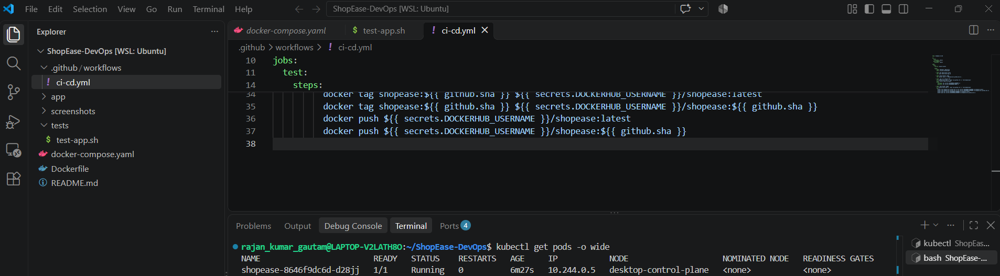
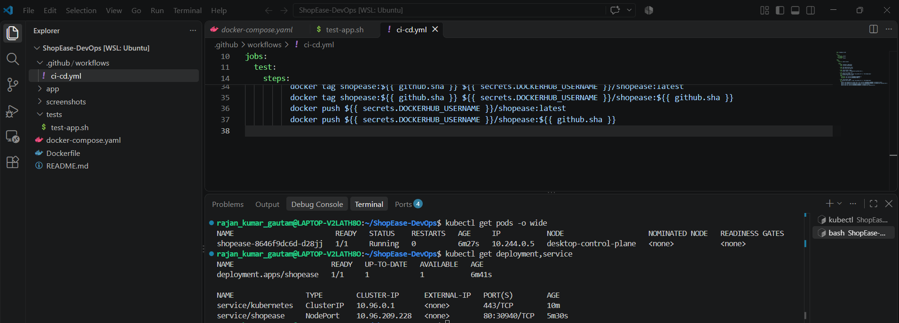
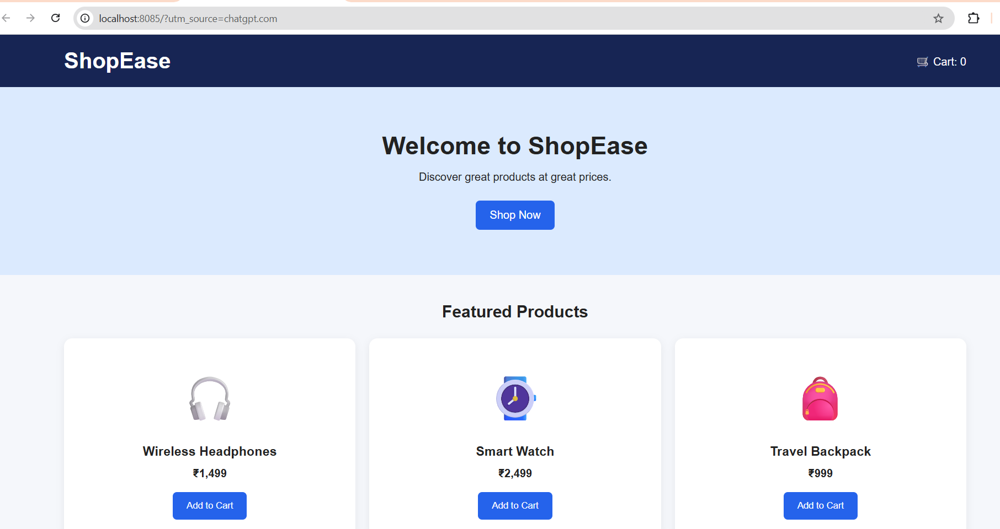

# ShopEase E-Commerce DevOps Project

## Project Overview
ShopEase is a simple e-commerce website developed as part of a DevOps internship project. The project will demonstrate containerization and automated CI/CD using GitHub Actions and Docker.

## Technologies Used
- HTML
- CSS
- JavaScript
- Git and GitHub
- Docker
- GitHub Actions
- Docker Hub

## Application Features
- Responsive e-commerce homepage
- Featured product cards
- Product prices
- Add to Cart functionality with a live cart counter

## Project Structure
```text
ShopEase-DevOps/
├── app/
│   ├── index.html
│   ├── style.css
│   └── script.js
├── screenshots/
├── .github/
│   └── workflows/
└── README.md
```
## Kubernetes Deployment

ShopEase was deployed locally on Kubernetes using Docker Desktop and a kind cluster.

### Tools Used
- Docker Desktop
- Kubernetes
- kubectl
- Docker Hub
- GitHub Actions

### Deployment Steps
1. Created a local Kubernetes cluster using kind.
2. Verified the Kubernetes node status using `kubectl get nodes`.
3. Created a deployment using the Docker Hub image `annapurna1993/shopease:latest`.
4. Exposed the deployment using a Kubernetes NodePort Service.
5. Used `kubectl port-forward` to access the application locally.

### Verification Commands
```bash
kubectl get nodes
kubectl get deployments
kubectl get pods -o wide
kubectl get services
```

### Screenshots

**Kubernetes Pods**



**Kubernetes Deployment and Service**



**ShopEase running in browser**


